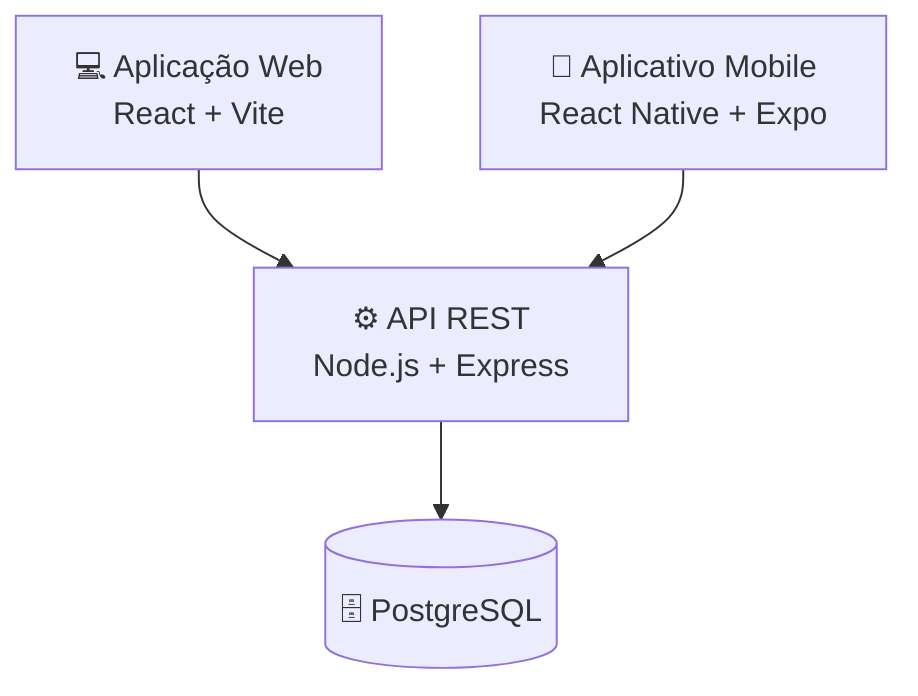

 <div align="center">


# 💚 FinanControl


<br>


</div>

---

## 💰 Sobre o projeto

O **FinanControl** é um sistema de controle financeiro pessoal desenvolvido com uma arquitetura Full Stack, integrando uma API REST, uma aplicação Web e um aplicativo Mobile.

O projeto foi desenvolvido com o objetivo de aplicar conhecimentos de desenvolvimento de sistemas, integração entre aplicações, gerenciamento de dados e construção de interfaces.

As três partes compartilham a mesma API, permitindo centralizar a comunicação e o gerenciamento das informações.

## ✨ Funcionalidades e módulos

<details>
<summary><strong>🌐 Aplicação Web</strong></summary>

- Interface desenvolvida com React.
- Navegação entre telas.
- Tela de login.
- Painel principal.
- Comunicação com a API REST.

</details>

<details>
<summary><strong>📱 Aplicativo Mobile</strong></summary>

- Aplicativo desenvolvido com React Native e Expo.
- Tela de login.
- Tela principal.
- Menu lateral de navegação.
- Navegação entre telas com React Navigation.

</details>

<details>
<summary><strong>⚙️ API Back-End</strong></summary>

- API REST desenvolvida com Node.js e Express.
- Autenticação de usuários.
- Cadastro, consulta, atualização e exclusão de usuários.
- Gerenciamento de produtos e categorias.
- Integração com PostgreSQL.
- Documentação interativa com Swagger.

</details>

## 🏗️ Arquitetura do sistema

O FinanControl possui três camadas principais que trabalham em conjunto:



<div align="center">

| Camada | Responsabilidade |
|:---:|---|
| 🌐 Web | Interface acessada pelo navegador |
| 📱 Mobile | Aplicativo para dispositivos móveis |
| ⚙️ API | Processamento e comunicação entre aplicações |
| 🗄️ Banco | Armazenamento das informações |

</div>

## 🛠️ Tecnologias utilizadas

### Back-End

<div align="center">


</div>

| Tecnologia | Utilização |
|---|---|
| Node.js | Ambiente de execução JavaScript |
| Express.js | Desenvolvimento da API REST |
| PostgreSQL | Banco de dados relacional |
| pg | Conexão com PostgreSQL |
| bcrypt | Hash de senhas |
| Swagger | Documentação da API |
| CORS | Controle de acesso entre origens |

### Front-End Web

<div align="center">


</div>

| Tecnologia | Utilização |
|---|---|
| React | Construção da interface |
| React Router DOM | Navegação entre páginas |
| Vite | Ambiente de desenvolvimento e build |
| JavaScript | Lógica da aplicação |
| ESLint | Padronização e análise do código |

### Aplicativo Mobile

<div align="center">


</div>

| Tecnologia | Utilização |
|---|---|
| React Native | Desenvolvimento mobile |
| Expo | Plataforma de desenvolvimento |
| React Navigation | Navegação entre telas |
| Gesture Handler | Manipulação de gestos |
| Reanimated | Animações |

## 📂 Estrutura do projeto

```text
FinanControl/
│
├── api/
│   ├── app.js
│   ├── db.js
│   ├── package.json
│   ├── config/
│   │   └── swagger.js
│   └── src/
│       └── routes/
│           ├── rotasUsuarios.js
│           └── rotasCategorias.js
│
├── frontend/
│   └── FinanControl/
│       ├── index.html
│       ├── package.json
│       └── src/
│           ├── App.jsx
│           ├── main.jsx
│           ├── pages/
│           │   ├── Login.jsx
│           │   └── Principal.jsx
│           ├── styles/
│           │   └── Estilos.jsx
│           └── utils.jsx
│
├── mobile/
│   └── FinanControl/
│       ├── App.js
│       ├── index.js
│       ├── app.json
│       └── src/
│           ├── pages/
│           │   ├── Login.js
│           │   ├── Principal.js
│           │   └── MenuDrawer.js
│           ├── styles/
│           │   └── Estilos.js
│           └── utils.js
│
└── .gitignore
```

## 🚀 Como executar o projeto

### Pré-requisitos

Antes de iniciar, é necessário ter instalado:

- [Node.js](https://nodejs.org/)
- [npm](https://www.npmjs.com/)
- [PostgreSQL](https://www.postgresql.org/)
- [Expo](https://expo.dev/)
- [Expo Go](https://expo.dev/go/) ou emulador configurado.

### 1. Clonar o repositório

```bash
git clone https://github.com/RafaelaSsilva28/FinanControl.git

cd FinanControl
```

### 2. Iniciar o Back-End

```bash
cd api
npm install
```

Configure a conexão com o PostgreSQL no arquivo `db.js`, utilizando os dados do seu ambiente local.

Depois, inicie a API:

```bash
npm start
```

A API estará disponível em:

```text
http://localhost:3000
```

### 3. Iniciar o Front-End Web

Em outro terminal:

```bash
cd frontend/FinanControl
npm install
npm run dev
```

A aplicação estará disponível em:

```text
http://localhost:5173
```

### 4. Iniciar o aplicativo Mobile

Em outro terminal:

```bash
cd mobile/FinanControl
npm install
npm start
```

Para executar em uma plataforma específica:

```bash
npm run android
npm run ios
npm run web
```

## 📡 Documentação da API

A API possui documentação interativa com Swagger.

Com o servidor em execução, acesse:

```text
http://localhost:3000/swagger
```

### Principais endpoints

| Método | Rota | Descrição |
|:---:|---|---|
| POST | `/login` | Autenticação |
| GET | `/usuarios` | Listar usuários |
| POST | `/usuarios` | Cadastrar usuário |
| PUT | `/usuarios/:id_usuario` | Atualizar usuário |
| DELETE | `/usuarios/:id_usuario` | Excluir usuário |
| GET | `/produtos` | Listar produtos |
| POST | `/produtos` | Cadastrar produto |
| PUT | `/produtos/:id_produto` | Atualizar produto |
| DELETE | `/produtos/:id_produto` | Excluir produto |
| GET | `/categorias` | Listar categorias |
| POST | `/categorias` | Cadastrar categoria |
| PUT | `/categorias/:id_categoria` | Atualizar categoria |
| DELETE | `/categorias/:id_categoria` | Excluir categoria |

## 🗄️ Banco de dados

O projeto utiliza **PostgreSQL** como banco de dados relacional.

Configuração local utilizada:

| Parâmetro | Valor |
|---|---|
| Host | `localhost` |
| Porta | `5432` |
| Database | `bd_produtos` |
| Usuário | `postgres` |

> As credenciais devem ser configuradas no ambiente local e não devem ser compartilhadas publicamente no repositório.

## 📚 Conhecimentos aplicados

Durante o desenvolvimento foram trabalhados conceitos como:

- Arquitetura Full Stack.
- Desenvolvimento de APIs REST.
- Integração entre Front-End e Back-End.
- Programação com JavaScript.
- Desenvolvimento Web com React.
- Desenvolvimento Mobile com React Native.
- Banco de dados PostgreSQL.
- Operações CRUD.
- Autenticação de usuários.
- Navegação entre telas.
- Organização e estruturação de projetos.
- Documentação de APIs com Swagger.

## 🌱 Objetivo do projeto

O FinanControl representa a aplicação prática de conhecimentos adquiridos durante o curso de Desenvolvimento de Sistemas.

O desenvolvimento de três aplicações integradas permite explorar diferentes ambientes de programação e compreender como os componentes de um sistema trabalham em conjunto.

---

<div align="center">

### 💚 Organização, tecnologia e evolução!

*Transformando conhecimentos em soluções.*

<br>


</div>
